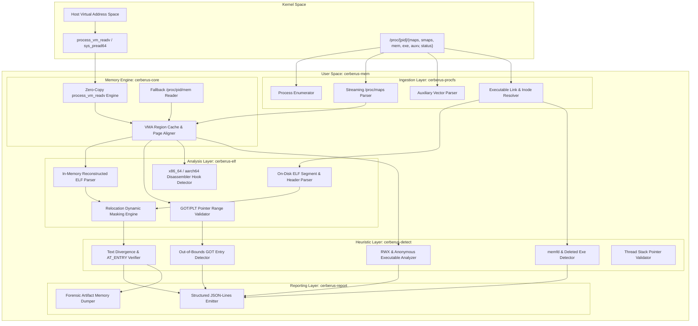

# Architecture & Kernel ABI Specification: Cerberus-Mem

**Target Artifact**: `linux-mem-forensics`  
**Classification**: Deep Systems Architecture, Kernel ABI Contracts & Memory Forensics Engine  
**Author**: Principal Systems Architect  
**Audience**: OpenCode Core Developer & Systems Security Engineers  

---

## 1. System Overview & Component Hierarchy

`cerberus-mem` is designed with a strict zero-compromise architectural hierarchy. It separates low-level kernel ABI abstractions from forensic analysis, symbol resolution, and detection heuristics. This modularity ensures that the parsing of untrusted, hostile memory structures never leads to panics, undefined behavior, or memory exhaustion.



---

## 2. Kernel ABI Contracts & Low-Level Syscall Interfaces

Forensic acquisition in Linux must interact directly with the kernel ABI without relying on invasive debugging hooks (`PTRACE_POKETEXT`) that modify the target's execution state or trip anti-forensic triggers.

### 2.1 Syscall: `process_vm_readv(2)`

The primary memory acquisition mechanism is `process_vm_readv(2)`. Unlike `ptrace(PTRACE_PEEKDATA, ...)`, which requires a kernel transition per 8-byte word and interrupts the target process, `process_vm_readv` performs an in-kernel zero-copy page transfer from the target's page tables directly into our allocated userspace buffer.

#### Syscall Signature
```c
ssize_t process_vm_readv(pid_t pid,
                         const struct iovec *local_iov,
                         unsigned long liovcnt,
                         const struct iovec *remote_iov,
                         unsigned long riovcnt,
                         unsigned long flags);
```

#### Rust ABI Binding Contract
```rust
#[repr(C)]
#[derive(Debug, Copy, Clone)]
pub struct IoVec {
    pub iov_base: *mut libc::c_void,
    pub iov_len: libc::size_t,
}

unsafe impl Send for IoVec {}
unsafe impl Sync for IoVec {}

pub unsafe fn sys_process_vm_readv(
    pid: libc::pid_t,
    local_iov: *const IoVec,
    liovcnt: libc::c_ulong,
    remote_iov: *const IoVec,
    riovcnt: libc::c_ulong,
    flags: libc::c_ulong,
) -> Result<usize, libc::c_int> {
    let ret = libc::syscall(
        libc::SYS_process_vm_readv,
        pid as libc::c_long,
        local_iov,
        liovcnt,
        remote_iov,
        riovcnt,
        flags,
    );

    if ret < 0 {
        Err(*libc::__errno_location())
    } else {
        Ok(ret as usize)
    }
}
```

#### Error Handling State Machine for `process_vm_readv`
```
                [Invoke process_vm_readv]
                           |
            +--------------+--------------+
            |                             |
      [Return >= 0]                  [Return < 0]
            |                             |
      (Success: Bytes)              [Evaluate Errno]
                                          |
                      +-------------------+-------------------+
                      |                   |                   |
                  [EFAULT]             [ESRCH]             [EPERM]
                      |                   |                   |
            (Page unmapped or       (Target PID         (Missing
             demand-paged;          exited; discard     CAP_SYS_PTRACE
             fallback to            process audit)      or YAMA LSM
             page-by-page read)                         rejection)
```

1. **`EFAULT` Handling**: In high-throughput Linux processes, memory mappings can change dynamically between reading `/proc/[pid]/maps` and executing the read syscall. Furthermore, if a page is uncommitted (demand-paged), `process_vm_readv` on a large contiguous range may fail with `EFAULT` entirely.
   - **Remediation Strategy**: If a multi-page chunk read fails with `EFAULT`, the engine automatically subdivides the request into individual $4096$-byte page requests, skipping dead or uncommitted pages while capturing all valid mapped pages.
2. **`EPERM` Handling**: If denied due to security boundaries, fallback to checking `PTRACE_MODE_READ_REALCREDS` or emitting an explicit privilege diagnostic.
3. **`ESRCH` Handling**: The target process terminated mid-scan. Clean up references immediately.

### 2.2 Fallback Acquisition: `/proc/[pid]/mem` via `pread64(2)`

When `process_vm_readv` is restricted or when analyzing stopped processes, `cerberus-mem` employs direct streaming reads against `/proc/[pid]/mem`.

```rust
pub struct ProcMemReader {
    fd: std::os::unix::io::RawFd,
    pid: libc::pid_t,
}

impl ProcMemReader {
    pub fn open(pid: libc::pid_t) -> std::io::Result<Self> {
        let path = format!("/proc/{}/mem", pid);
        let c_path = std::ffi::CString::new(path).unwrap();
        // O_RDONLY | O_LARGEFILE | O_CLOEXEC
        let fd = unsafe {
            libc::open(
                c_path.as_ptr(),
                libc::O_RDONLY | libc::O_CLOEXEC | 0o100000, // O_LARGEFILE on 64-bit Linux
            )
        };
        if fd < 0 {
            return Err(std::io::Error::last_os_error());
        }
        Ok(Self { fd, pid })
    }

    pub fn read_exact_at(&self, buf: &mut [u8], remote_addr: u64) -> std::io::Result<usize> {
        let mut total_read = 0;
        while total_read < buf.len() {
            let res = unsafe {
                libc::pread64(
                    self.fd,
                    buf[total_read..].as_mut_ptr() as *mut libc::c_void,
                    buf.len() - total_read,
                    (remote_addr + total_read as u64) as libc::off64_t,
                )
            };
            if res < 0 {
                let err = std::io::Error::last_os_error();
                if err.raw_os_error() == Some(libc::EINTR) {
                    continue;
                }
                return Err(err);
            }
            if res == 0 {
                break; // EOF
            }
            total_read += res as usize;
        }
        Ok(total_read)
    }
}

impl Drop for ProcMemReader {
    fn drop(&mut self) {
        if self.fd >= 0 {
            unsafe { libc::close(self.fd); }
        }
    }
}
```

---

## 3. Procfs Streaming Parser Architecture

Parsing `/proc/[pid]/maps` without allocations is paramount for avoiding memory bloat when scanning thousands of processes with deep address spaces.

### 3.1 Mapping Format Specification
Standard Linux `/proc/[pid]/maps` format:
```
address           perms offset  dev   inode       pathname
00400000-00452000 r-xp 00000000 08:02 173521      /usr/bin/dbus-daemon
00651000-00652000 r--p 00051000 08:02 173521      /usr/bin/dbus-daemon
00652000-00655000 rw-p 00052000 08:02 173521      /usr/bin/dbus-daemon
7fff5be2a000-7fff5be4b000 rw-p 00000000 00:00 0   [stack]
7fff5be7f000-7fff5be83000 r--p 00000000 00:00 0   [vvar]
7fff5be83000-7fff5be85000 r-xp 00000000 00:00 0   [vdso]
ffffffffff600000-ffffffffff601000 --xp 00000000 00:00 0 [vsyscall]
```

### 3.2 Pure Rust VMA Data Model
```rust
use bitflags::bitflags;

bitflags! {
    #[derive(Debug, Clone, Copy, PartialEq, Eq, PartialOrd, Ord, Hash)]
    pub struct VmaProtection: u8 {
        const READ    = 0b0000_0001;
        const WRITE   = 0b0000_0010;
        const EXEC    = 0b0000_0100;
        const SHARED  = 0b0000_1000;
        const PRIVATE = 0b0001_0000;
    }
}

#[derive(Debug, Clone, PartialEq, Eq)]
pub enum VmaBacking {
    Anonymous,
    File(std::path::PathBuf),
    Heap,
    Stack,
    Vdso,
    Vvar,
    Vsyscall,
    Memfd(String),
    Deleted(std::path::PathBuf),
}

#[derive(Debug, Clone, PartialEq, Eq)]
pub struct VmaRecord {
    pub start: u64,
    pub end: u64,
    pub perms: VmaProtection,
    pub offset: u64,
    pub dev_major: u32,
    pub dev_minor: u32,
    pub inode: u64,
    pub backing: VmaBacking,
}

impl VmaRecord {
    #[inline(always)]
    pub fn size(&self) -> u64 {
        self.end.saturating_sub(self.start)
    }

    #[inline(always)]
    pub fn is_executable(&self) -> bool {
        self.perms.contains(VmaProtection::EXEC)
    }

    #[inline(always)]
    pub fn is_rwx(&self) -> bool {
        self.perms.contains(VmaProtection::READ | VmaProtection::WRITE | VmaProtection::EXEC)
    }

    #[inline(always)]
    pub fn is_anonymous_exec(&self) -> bool {
        self.is_executable() && matches!(self.backing, VmaBacking::Anonymous | VmaBacking::Heap)
    }
}
```

### 3.3 Zero-Allocation Streaming Parser Implementation
```rust
pub struct MapsParser<'a> {
    buffer: &'a [u8],
    cursor: usize,
}

#[derive(Debug, PartialEq, Eq)]
pub enum MapsParseError {
    InvalidAddressRange,
    InvalidPermissions,
    InvalidOffset,
    InvalidDevice,
    InvalidInode,
    UnexpectedEof,
}

impl<'a> MapsParser<'a> {
    pub fn new(buffer: &'a [u8]) -> Self {
        Self { buffer, cursor: 0 }
    }

    pub fn parse_next(&mut self) -> Result<Option<VmaRecord>, MapsParseError> {
        if self.cursor >= self.buffer.len() {
            return Ok(None);
        }

        let line_end = match self.buffer[self.cursor..].iter().position(|&b| b == b'\n') {
            Some(idx) => self.cursor + idx,
            None => self.buffer.len(),
        };

        let line = &self.buffer[self.cursor..line_end];
        self.cursor = if line_end < self.buffer.len() { line_end + 1 } else { line_end };

        if line.is_empty() {
            return Ok(None);
        }

        Self::parse_line(line).map(Some)
    }

    fn parse_line(line: &[u8]) -> Result<VmaRecord, MapsParseError> {
        let mut parts = line.split(|&b| b == b' ').filter(|p| !p.is_empty());

        // Part 1: Address range "00400000-00452000"
        let addr_range = parts.next().ok_or(MapsParseError::UnexpectedEof)?;
        let dash_pos = addr_range.iter().position(|&b| b == b'-').ok_or(MapsParseError::InvalidAddressRange)?;
        let start = parse_hex_u64(&addr_range[..dash_pos]).ok_or(MapsParseError::InvalidAddressRange)?;
        let end = parse_hex_u64(&addr_range[dash_pos + 1..]).ok_or(MapsParseError::InvalidAddressRange)?;

        // Part 2: Permissions "r-xp"
        let perms_bytes = parts.next().ok_or(MapsParseError::UnexpectedEof)?;
        if perms_bytes.len() < 4 {
            return Err(MapsParseError::InvalidPermissions);
        }
        let mut perms = VmaProtection::empty();
        if perms_bytes[0] == b'r' { perms |= VmaProtection::READ; }
        if perms_bytes[1] == b'w' { perms |= VmaProtection::WRITE; }
        if perms_bytes[2] == b'x' { perms |= VmaProtection::EXEC; }
        if perms_bytes[3] == b's' { perms |= VmaProtection::SHARED; }
        if perms_bytes[3] == b'p' { perms |= VmaProtection::PRIVATE; }

        // Part 3: Offset
        let offset_bytes = parts.next().ok_or(MapsParseError::UnexpectedEof)?;
        let offset = parse_hex_u64(offset_bytes).ok_or(MapsParseError::InvalidOffset)?;

        // Part 4: Device "08:02"
        let dev_bytes = parts.next().ok_or(MapsParseError::UnexpectedEof)?;
        let colon_pos = dev_bytes.iter().position(|&b| b == b':').ok_or(MapsParseError::InvalidDevice)?;
        let dev_major = parse_hex_u32(&dev_bytes[..colon_pos]).ok_or(MapsParseError::InvalidDevice)?;
        let dev_minor = parse_hex_u32(&dev_bytes[colon_pos + 1..]).ok_or(MapsParseError::InvalidDevice)?;

        // Part 5: Inode
        let inode_bytes = parts.next().ok_or(MapsParseError::UnexpectedEof)?;
        let inode = parse_decimal_u64(inode_bytes).ok_or(MapsParseError::InvalidInode)?;

        // Part 6: Pathname (optional)
        let pathname: Option<&[u8]> = parts.next();
        let backing = match pathname {
            None => VmaBacking::Anonymous,
            Some(path) => {
                let s = std::str::from_utf8(path).unwrap_or("");
                if s == "[heap]" {
                    VmaBacking::Heap
                } else if s == "[stack]" || s.starts_with("[stack:") {
                    VmaBacking::Stack
                } else if s == "[vdso]" {
                    VmaBacking::Vdso
                } else if s == "[vvar]" {
                    VmaBacking::Vvar
                } else if s == "[vsyscall]" {
                    VmaBacking::Vsyscall
                } else if s.starts_with("/memfd:") {
                    VmaBacking::Memfd(s.to_string())
                } else if s.ends_with(" (deleted)") {
                    let clean_path = s.trim_end_matches(" (deleted)");
                    VmaBacking::Deleted(std::path::PathBuf::from(clean_path))
                } else {
                    VmaBacking::File(std::path::PathBuf::from(s))
                }
            }
        };

        Ok(VmaRecord {
            start,
            end,
            perms,
            offset,
            dev_major,
            dev_minor,
            inode,
            backing,
        })
    }
}

#[inline(always)]
fn parse_hex_u64(slice: &[u8]) -> Option<u64> {
    let mut val = 0u64;
    for &b in slice {
        let digit = match b {
            b'0'..=b'9' => (b - b'0') as u64,
            b'a'..=b'f' => (b - b'a' + 10) as u64,
            b'A'..=b'F' => (b - b'A' + 10) as u64,
            _ => return None,
        };
        val = val.checked_shl(4)?.checked_add(digit)?;
    }
    Some(val)
}

#[inline(always)]
fn parse_hex_u32(slice: &[u8]) -> Option<u32> {
    parse_hex_u64(slice).map(|v| v as u32)
}

#[inline(always)]
fn parse_decimal_u64(slice: &[u8]) -> Option<u64> {
    let mut val = 0u64;
    for &b in slice {
        if !b.is_ascii_digit() { return None; }
        val = val.checked_mul(10)?.checked_add((b - b'0') as u64)?;
    }
    Some(val)
}
```

---

## 4. Auxiliary Vector (`/proc/[pid]/auxv`) Parsing & Anchor Contract

Linux loader `ld-linux.so` passes auxiliary vectors from kernel to userspace at process boot. These values provide immutable forensic anchors that the adversary cannot cleanly rewrite without invalidating glibc state.

### 4.1 Relevant ELF Auxiliary Vector Types (`elf.h`)
```rust
pub const AT_NULL: u64 = 0;
pub const AT_PHDR: u64 = 3;     // Address of Program Headers in virtual memory
pub const AT_PHENT: u64 = 4;    // Size of one Program Header entry
pub const AT_PHNUM: u64 = 5;    // Number of Program Header entries
pub const AT_PAGESZ: u64 = 6;   // System page size (4096)
pub const AT_BASE: u64 = 7;     // Base address of the dynamic linker (ld-linux.so)
pub const AT_FLAGS: u64 = 8;    // Flags
pub const AT_ENTRY: u64 = 9;    // Entry point address of the main executable
pub const AT_EXECFN: u64 = 31;  // Pointer to filename string
```

### 4.2 Forensic Auxv Struct & Parser
```rust
#[repr(C)]
#[derive(Debug, Copy, Clone)]
pub struct Elf64AuxvEntry {
    pub a_type: u64,
    pub a_val: u64,
}

#[derive(Debug, Clone, Default)]
pub struct ProcessAuxvAnchors {
    pub phdr_addr: Option<u64>,
    pub phent_size: Option<u64>,
    pub phnum: Option<u64>,
    pub base_addr: Option<u64>,
    pub entry_point: Option<u64>,
    pub execfn_ptr: Option<u64>,
}

impl ProcessAuxvAnchors {
    pub fn parse_from_bytes(data: &[u8]) -> Result<Self, &'static str> {
        let entry_size = std::mem::size_of::<Elf64AuxvEntry>();
        if data.len() % entry_size != 0 {
            return Err("Malformed auxv buffer size");
        }

        let mut anchors = Self::default();
        for chunk in data.chunks_exact(entry_size) {
            let a_type = u64::from_ne_bytes(chunk[0..8].try_into().unwrap());
            let a_val = u64::from_ne_bytes(chunk[8..16].try_into().unwrap());

            match a_type {
                AT_NULL => break,
                AT_PHDR => anchors.phdr_addr = Some(a_val),
                AT_PHENT => anchors.phent_size = Some(a_val),
                AT_PHNUM => anchors.phnum = Some(a_val),
                AT_BASE => anchors.base_addr = Some(a_val),
                AT_ENTRY => anchors.entry_point = Some(a_val),
                AT_EXECFN => anchors.execfn_ptr = Some(a_val),
                _ => {}
            }
        }
        Ok(anchors)
    }
}
```

---

## 5. Differential Memory Analysis & Relocation Masking Engine

To detect process hollowing or `.text` tampering, `cerberus-mem` compares the memory segment with the disk binary. However, dynamic linkers rewrite memory during execution (relocations, GOT resolutions, PLT jumps). A naive byte-for-byte comparison generates false positives.

```
+-------------------------------------------------------------------------+
|                  DIFFERENTIAL ANALYSIS PIPELINE                         |
+-------------------------------------------------------------------------+
|  [On-Disk Binary: /usr/bin/foo]                                         |
|    - Parse ELF headers: e_entry, PT_LOAD, .text offset, .rela.dyn       |
|    - Extract static .text raw bytes                                     |
+-------------------------------------------------------------------------+
                               |
                               v
|  [Calculate Relocation Mask]                                            |
|    - Identify dynamic relocation offsets inside .text:                  |
|        * R_X86_64_RELATIVE                                             |
|        * R_X86_64_GLOB_DAT                                              |
|        * R_X86_64_JUMP_SLOT                                             |
|    - Construct Bitmask / Exemption Intervals: ignore dynamic patch sites|
+-------------------------------------------------------------------------+
                               |
                               v
|  [Live In-Memory VMA: 0x00400000]                                       |
|    - Read VMA via process_vm_readv(2)                                   |
|    - Apply Relocation Mask to zero-out expected dynamic differences     |
|    - Compute SHA-256 / SimHash of masked buffers                        |
+-------------------------------------------------------------------------+
                               |
                               v
|  [Evaluate Divergence]                                                  |
|    - Identical Hash -> Clean Segment                                    |
|    - Hash Divergence -> Alert: High Severity Code Injection             |
|    - Extract exact diverging byte offsets & disassemble modified code   |
+-------------------------------------------------------------------------+
```

### 5.1 Relocation Exemption Mask Struct
```rust
#[derive(Debug, Clone)]
pub struct RelocationInterval {
    pub offset_in_segment: usize,
    pub length: usize,
}

pub struct RelocationMask {
    pub intervals: Vec<RelocationInterval>,
}

impl RelocationMask {
    pub fn new() -> Self {
        Self { intervals: Vec::new() }
    }

    pub fn add_interval(&mut self, offset: usize, length: usize) {
        self.intervals.push(RelocationInterval { offset_in_segment: offset, length });
    }

    pub fn apply_mask(&self, buffer: &mut [u8]) {
        for interval in &self.intervals {
            let start = interval.offset_in_segment;
            let end = start + interval.length;
            if start < buffer.len() {
                let actual_end = end.min(buffer.len());
                // Mask with zeroes
                buffer[start..actual_end].fill(0);
            }
        }
    }
}
```

---

## 6. GOT/PLT Pointer Range & Link Map Validation

The Global Offset Table (`.got`) and Procedure Linkage Table (`.got.plt`) contain function pointers used to resolve calls to shared libraries dynamically. In attacks like GOT hijacking, an attacker overwrites an entry with the address of shellcode or a rogue gadget.

### 6.1 Validation Logic
For every entry in `.got.plt`:
1. Read target function address $A_{target}$ from the target's memory.
2. Query the process's loaded VMA map to determine which VMA contains $A_{target}$.
3. **Safety Assertions**:
   - $A_{target}$ MUST reside within an executable segment (`VmaProtection::EXEC`).
   - The containing VMA MUST be backed by a legitimate shared library (e.g. `libc.so.6`, `libssl.so.3`) or the main binary itself.
   - If $A_{target}$ points to an anonymous VMA (`[anon]`), a heap VMA (`[heap]`), or a writable VMA (`PROT_WRITE`), immediately flag as **CRITICAL: GOT Poisoning / Hijack**.

```rust
#[derive(Debug, Clone)]
pub struct GotEntryForensic {
    pub symbol_name: String,
    pub got_address: u64,
    pub target_pointer: u64,
    pub target_vma_backing: Option<VmaBacking>,
    pub is_valid: bool,
    pub anomaly_reason: Option<String>,
}

pub fn verify_got_entries(
    target_pid: libc::pid_t,
    got_entries: &[(String, u64)], // (symbol, address_of_got_slot)
    vmas: &[VmaRecord],
    reader: &ProcMemReader,
) -> Vec<GotEntryForensic> {
    let mut results = Vec::new();

    for (symbol, got_addr) in got_entries {
        let mut ptr_buf = [0u8; 8];
        if reader.read_exact_at(&mut ptr_buf, *got_addr).is_err() {
            continue;
        }
        let target_ptr = u64::from_ne_bytes(ptr_buf);

        // Find containing VMA
        let containing_vma = vmas.iter().find(|v| target_ptr >= v.start && target_ptr < v.end);

        match containing_vma {
            None => {
                results.push(GotEntryForensic {
                    symbol_name: symbol.clone(),
                    got_address: *got_addr,
                    target_pointer: target_ptr,
                    target_vma_backing: None,
                    is_valid: false,
                    anomaly_reason: Some(format!("Target 0x{:x} points outside all mapped VMAs", target_ptr)),
                });
            }
            Some(vma) => {
                if !vma.is_executable() {
                    results.push(GotEntryForensic {
                        symbol_name: symbol.clone(),
                        got_address: *got_addr,
                        target_pointer: target_ptr,
                        target_vma_backing: Some(vma.backing.clone()),
                        is_valid: false,
                        anomaly_reason: Some(format!("Target 0x{:x} resides in non-executable VMA", target_ptr)),
                    });
                } else if matches!(vma.backing, VmaBacking::Anonymous | VmaBacking::Heap | VmaBacking::Stack) {
                    results.push(GotEntryForensic {
                        symbol_name: symbol.clone(),
                        got_address: *got_addr,
                        target_pointer: target_ptr,
                        target_vma_backing: Some(vma.backing.clone()),
                        is_valid: false,
                        anomaly_reason: Some(format!("Target 0x{:x} points to anonymous/heap/stack memory", target_ptr)),
                    });
                } else {
                    results.push(GotEntryForensic {
                        symbol_name: symbol.clone(),
                        got_address: *got_addr,
                        target_pointer: target_ptr,
                        target_vma_backing: Some(vma.backing.clone()),
                        is_valid: true,
                        anomaly_reason: None,
                    });
                }
            }
        }
    }

    results
}
```

---

## 7. Inline Hook Trampoline Detection

Inline hooking overwrites the prologue of standard library functions with jump instructions. 
Common trampolines on x86_64:
1. **5-byte Relative Jump**: `0xE9 <i32_offset>` (`jmp rel32`)
2. **14-byte Absolute Jump**: `0xFF 0x25 0x00 0x00 0x00 0x00 <u64_addr>` (`jmpq *(%rip)`)
3. **12-byte R11/RAX Absolute Jump**: `0x48 0xB8 <u64_addr> 0xFF 0xE0` (`movabs $addr, %rax; jmp *%rax`)

### Detection Strategy
For high-value API symbols in loaded `libc.so` (e.g. `openat`, `execve`, `read`, `write`, `ptrace`, `connect`, `system`):
1. Resolve the symbol's expected virtual address $A_{sym}$.
2. Read the first 16 bytes from memory at $A_{sym}$.
3. Compare against the expected prologue from on-disk `libc.so`.
4. If instruction decoding shows an immediate absolute or relative jump, calculate destination address $D_{target}$.
5. If $D_{target}$ falls outside `libc.so` `.text` VMA boundaries, raise **HIGH: Inline Hook Trampoline Detected**.

---

## 8. Data Models & Forensic Output Schema

`cerberus-mem` outputs detections as structured JSON-Lines events.

```rust
use serde::{Serialize, Deserialize};

#[derive(Debug, Serialize, Deserialize)]
#[serde(rename_all = "snake_case")]
pub enum Severity {
    Info,
    Low,
    Medium,
    High,
    Critical,
}

#[derive(Debug, Serialize, Deserialize)]
#[serde(rename_all = "snake_case")]
pub enum AnomalyType {
    FilelessMemfdExecution,
    DeletedBinaryExecution,
    ProcessHollowing,
    TextSegmentModification,
    GotPltHijack,
    InlineFunctionHook,
    WxorXViolation,
    AnonymousExecutableMapping,
    StackPivoting,
}

#[derive(Debug, Serialize, Deserialize)]
pub struct ForensicFinding {
    pub timestamp_utc: String,
    pub target_pid: u32,
    pub process_comm: String,
    pub process_cmdline: Vec<String>,
    pub severity: Severity,
    pub anomaly_type: AnomalyType,
    pub description: String,
    pub affected_address_range: (u64, u64),
    pub backing_detail: String,
    pub disk_hash_sha256: Option<String>,
    pub mem_hash_sha256: Option<String>,
    pub extracted_divergence_bytes: Option<String>, // Hex-encoded modified bytes
    pub disassembly_snippet: Option<Vec<String>>,
}
```

---

## 9. Failure Modes & Graceful Degradation

| Failure Mode | Trigger Condition | Engine Behavior | Recovery / Diagnostic |
| :--- | :--- | :--- | :--- |
| **`EFAULT` on Memory Read** | Page unmapped or dynamic unmap race | Catch `EFAULT`, fallback to single-page scanning | Skip dead pages, log partial VMA dump |
| **`EPERM` on Syscall** | YAMA ptrace_scope or missing capability | Drop from direct syscall to unprivileged `/proc` metrics | Emit warning requesting `CAP_SYS_PTRACE` |
| **Target Exit (`ESRCH`)** | Process terminates during inspection | Catch `ESRCH` / ENOENT on procfs files | Abort process audit cleanly, proceed to next PID |
| **Target Anti-Debug Trap** | Target monitors ptrace attachment | Do not use `ptrace` for scanning; rely on `process_vm_readv` | Target remains unpaused and unaware of inspection |
| **Disk Binary Inaccessible** | Binary deleted or in unreachable mount namespace | Cannot perform differential disk hash | Flag as suspicious unbacked/deleted execution |
