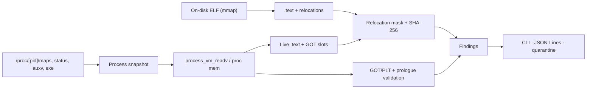

<p align="center">
  
</p>

<p align="center">
  <a href="https://github.com/devpryan7792/cerberus-mem/actions/workflows/ci.yml"></a>
  
  
  
  
</p>

<p align="center">
  <strong>Passive Linux memory forensics for code that never touches disk.</strong><br>
  Differential ELF analysis · GOT/PLT integrity · inline hooks · fileless execution · W^X.
</p>

---

Cerberus-Mem inspects live Linux processes without pausing them. It compares
each process's on-disk ELF image with its mapped memory, validates dynamic-linker
data structures, and flags code that only exists in RAM. The engine uses
`process_vm_readv(2)` with a `/proc/[pid]/mem` fallback — never `ptrace` — so
targets keep running and anti-debug checks do not trip.

## Why

`auditd` sees syscalls, not memory. On-disk scanners see files, not mapped pages.
Both miss the modern Linux playbook: `memfd_create` + `fexecve`, overwritten
`.text`, hooked GOT slots, and inline trampolines in libc.

| Capability | auditd | On-disk AV | Cerberus-Mem |
|---|:---:|:---:|:---:|
| Code that exists only in RAM | ❌ | ❌ | ✅ |
| Running `.text` vs disk divergence | ❌ | ❌ | ✅ |
| GOT/PLT pointer validation | ❌ | ❌ | ✅ |
| Inline hook trampolines | ❌ | ❌ | ✅ |
| W^X and anonymous executable pages | ⚠️ | ❌ | ✅ |

<sub>Capability comparison for default configurations, not a benchmark. `auditd` can be extended with custom rules, but it has no ELF- or VMA-aware integrity checks out of the box.</sub>

## Demo

<p align="center">
  
</p>

<p align="center"><sub>Live host sweep, then a synthetic lab target combining a memfd payload, GOT hijack, and <code>.text</code> tampering.</sub></p>

## Quick start

```bash
git clone https://github.com/devpryan7792/cerberus-mem.git
cd cerberus-mem

cargo build --release
sudo setcap cap_sys_ptrace,cap_dac_read_search+ep target/release/cerberus-mem

./target/release/cerberus-mem --all
```

Or install it directly:

```bash
cargo install --git https://github.com/devpryan7792/cerberus-mem \
  cerberus-cli --bin cerberus-mem --locked
sudo setcap cap_sys_ptrace,cap_dac_read_search+ep "$(command -v cerberus-mem)"
```

## Usage

```bash
cerberus-mem --pid 1234                                  # one process
cerberus-mem --all                                       # full host sweep
cerberus-mem --all --jsonl findings.jsonl                # JSON-Lines, append mode
cerberus-mem --all --max-threads 4                       # bound CPU usage
cerberus-mem --daemon --interval 30 \
  --quarantine-dir /var/log/cerberus/dumps               # continuous sweep
```

Findings are printed to stdout. `--jsonl` writes one JSON object per line for
SIEM ingestion while keeping stdout quiet.

Daemon mode caps the scanner at 4 worker threads so a continuous sweep leaves
headroom for the host's own work; `--max-threads` overrides it.

If YAMA or missing capabilities prevent inspection of foreign processes, the
tool says so explicitly instead of silently returning fewer findings.

## What it detects

| Signal | Method | Severity |
|---|---|---|
| **Fileless execution** | `/proc/[pid]/exe` resolves to `memfd:` or a deleted file | Critical |
| **Process hollowing** | Relocation-masked SHA-256 of disk `.text` vs the live mapping; divergent bytes extracted | High |
| **GOT/PLT poisoning** | Imported function slots must resolve inside the expected module's executable/PLT ranges | High |
| **Inline hooks** | Decode exported prologues and resolve `JMP`/`CALL` targets into foreign mappings | High |
| **W^X violations** | VMA is writable and executable at the same time | High |
| **Anonymous executable pages** | Unbacked executable VMA, with an allowlist for known JIT runtimes | Medium / Critical |

Every finding carries a timestamp, PID, comm, command line, address range,
backing detail, and optional disk/memory hashes and disassembly.

## How it works



- One metadata and VMA collection pass per PID, shared by every detector.
- On-disk executables are memory-mapped, not copied into the heap, and each
  binary is parsed once per sweep regardless of how many processes map it.
- GOT slot reads are batched into 64 KiB windows.
- Host sweeps run across a Rayon worker pool and finish in roughly 260 ms for
  330+ processes.
- Unreadable pages degrade to zero-filled reads without being counted as
  transferred; `EPERM` retries through `/proc/[pid]/mem`.
- Targets are probed for readability first, so an unprivileged sweep does not
  parse large binaries it is not permitted to read.
- A process that `execve`s mid-scan is detected and re-snapshotted, so a torn
  address space is never reported as a threat.

## Output

```json
{
  "timestamp_utc": "2026-11-06T12:40:27.397059885+00:00",
  "target_pid": 1631,
  "process_comm": "quickshell",
  "process_cmdline": ["quickshell", "-d"],
  "severity": "high",
  "anomaly_type": "wxor_x_violation",
  "description": "Mapping at 0x7f0401a2e000-0x7f0401a3e000 is simultaneously writable and executable",
  "affected_address_range": [139655184048128, 139655184113664],
  "backing_detail": "Anonymous",
  "disk_hash_sha256": null,
  "mem_hash_sha256": null,
  "extracted_divergence_bytes": null,
  "disassembly_snippet": null
}
```

Quarantined artifacts land in a `0700` directory. Files are created exclusively
with mode `0600` and `O_NOFOLLOW | O_CREAT | O_EXCL`, so existing symlinks or
files are never followed or overwritten.

## Performance

Measured on a 12-core x86_64 host with ~330 visible PIDs, release build:

| Gate | Result | Target |
|---|---|---|
| Single-PID scan, p99 | **~105 µs** | < 1.5 ms |
| Full host sweep | **~260 ms** | < 500 ms (scaled to PID count) |

```bash
cargo bench -p cerberus-cli
cargo test -p cerberus-cli --release --test sla_test -- --ignored --nocapture
```

The latency gate scans a spawned target process; the sweep gate is the best of
three full `/proc` walks. The sweep budget scales with the number of visible
processes using the charter's own 300-process/500 ms reference point, so a
larger host gets proportionally more time while still enforcing the per-process
allowance.

## Permissions and safety

- Host-wide inspection needs `CAP_SYS_PTRACE`; same-user targets can work
  unprivileged when YAMA `ptrace_scope` permits it.
- No `ptrace`, no process suspension, no code injection.
- Kernel-space rootkits and a compromised `/proc` are out of scope.
- This is a forensic inspection tool, not a sandbox. Use it only on systems you
  own or are authorized to examine.

## Project layout

```text
crates/
├── cerberus-core     # process_vm_readv + /proc/[pid]/mem readers, syscall ABI
├── cerberus-procfs   # maps, status, auxv, enumeration, YAMA, snapshot checks
├── cerberus-elf      # mmap-backed ELF, relocations, dynamic symbols, GOT/PLT
├── cerberus-detect   # fileless, hollowing, GOT, inline hook, W^X engines
├── cerberus-report   # finding models, JSON-Lines, secure quarantine
└── cerberus-cli      # cerberus-mem binary, sweep orchestration, benchmarks
```

## Testing

```bash
cargo fmt --all -- --check
cargo clippy --workspace --all-targets -- -D warnings
cargo test --workspace -- --test-threads=1
```

The suite runs real-kernel adversarial probes, not mocks: an actual
`memfd_create` + `execveat` payload, in-memory `.text` tampering, a synthetic
GOT hijack, clean-process false-positive checks, address-space snapshot
consistency, and JSON-Lines emission.

## Status and roadmap

- [x] Passive `process_vm_readv` reader with `/proc/[pid]/mem` fallback
- [x] Relocation-masked `.text` differential analysis
- [x] GOT/PLT pointer verification
- [x] Inline hook trampoline detection
- [x] JSON-Lines output and secure quarantine
- [x] Criterion benchmarks and p99/sweep SLA gates
- [x] Torn-snapshot detection for processes that `execve` mid-scan
- [x] Bounded scanner thread pool (`--max-threads`)
- [ ] On-disk prologue comparison for inline hooks
- [ ] Stack pivot detection
- [ ] `cargo-fuzz`, proptest, and mutation testing in CI
- [ ] Distro packages and signed releases

## Documentation

| Document | Contents |
|---|---|
| [`PROJECT_CHARTER.md`](PROJECT_CHARTER.md) | Threat model, scope, operational constraints |
| [`ARCHITECTURE_SPEC.md`](ARCHITECTURE_SPEC.md) | Data structures, parsers, and detection algorithms |
| [`PHASED_IMPLEMENTATION.md`](PHASED_IMPLEMENTATION.md) | Implementation contract and verification gates |
| [`TESTING_AND_VERIFICATION.md`](TESTING_AND_VERIFICATION.md) | Test strategy and tooling |
| [`ROADMAP.md`](ROADMAP.md) | Milestones and risk register |

## Contributing

Issues and pull requests are welcome. Before opening a PR, run the format,
clippy, and test commands above; CI runs the same gates on every push.

## License

Apache-2.0. See [`LICENSE`](LICENSE).
