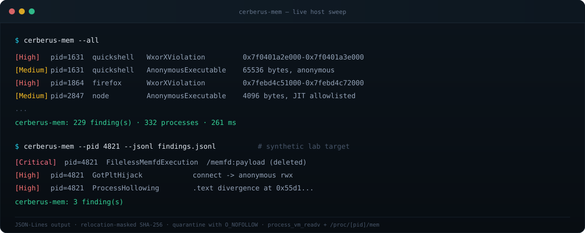

<p align="center">
  
</p>

<p align="center">
  <a href="https://github.com/devpryan7792/cerberus-mem/actions/workflows/ci.yml"></a>
  <a href="LICENSE"></a>
  <a href="https://crates.io/crates/cerberus-cli"></a>
  
</p>

<p align="center">
  <b>Passive Linux memory forensics.</b> Compares live process memory against
  on-disk ELF images, validates dynamic-linker state, and finds code that only
  ever existed in RAM.
</p>

---

## Why

`auditd` records syscalls. On-disk scanners read files. Neither looks at the
pages a running process actually has mapped — which is where `memfd_create`
payloads, hollowed daemons, poisoned GOT slots, and hooked libc functions
live.

Cerberus-Mem reads a target's address space with `process_vm_readv(2)` (falling
back to `/proc/[pid]/mem`) and never attaches with `ptrace`. The target keeps
running and never sees the inspection.

## Install

```bash
git clone https://github.com/devpryan7792/cerberus-mem.git
cd cerberus-mem
cargo build --release
```

```bash
# or
cargo install --git https://github.com/devpryan7792/cerberus-mem cerberus-cli --bin cerberus-mem --locked
```

Host-wide inspection needs `CAP_SYS_PTRACE`:

```bash
sudo setcap cap_sys_ptrace,cap_dac_read_search+ep target/release/cerberus-mem
```

Same-user targets work unprivileged under `ptrace_scope=0`.

## Use

```bash
cerberus-mem --pid 1234                  # single process
cerberus-mem --all                       # whole host
cerberus-mem --all --jsonl out.jsonl     # JSON-Lines for SIEM ingestion
cerberus-mem --all --max-threads 4       # cap CPU usage
cerberus-mem --daemon --interval 30 \
  --quarantine-dir /var/log/cerberus     # continuous sweep
```

<p align="center">
  
</p>

## Detections

| Type | Method | Severity |
|---|---|---|
| `FilelessMemfdExecution` | `/proc/[pid]/exe` resolves to `memfd:` or a deleted file | Critical |
| `ProcessHollowing` | Relocation-masked SHA-256 of disk `.text` vs live mapping | Critical |
| `GotPltHijack` | Imported GOT slot resolves outside the expected module's PLT | Critical |
| `InlineFunctionHook` | Exported prologue contains a `JMP`/`CALL` into a foreign mapping | High |
| `WxorXViolation` | VMA is writable and executable simultaneously | High |
| `AnonymousExecutableMapping` | Unbacked executable VMA, above 64 KiB without a JIT allowlist | Medium → Critical |

Every finding carries a timestamp, PID, comm, argv, address range, backing
detail, and — where applicable — disk and memory SHA-256 hashes, the divergent
bytes, and a disassembly of the altered instructions.

## Design notes

**Relocation masking.** A PIE binary's `.text` is rewritten by `ld-linux` at
load time. Hashing disk `.text` against memory without accounting for
`.rela.dyn` and `.rela.plt` produces a 100% false-positive rate. The engine
zeroes every relocation interval on both sides before comparing.

**Batched GOT reads.** GOT slots are clustered, so the engine sorts them and
slurps contiguous 64 KiB windows instead of issuing one syscall per slot.

**Snapshot consistency.** A process that calls `execve` mid-scan swaps its
entire address space. Maps read before the `execve` and memory read after it
describe different layouts, and mixing them invents threats that do not exist.
The scanner detects the swap and re-snapshots.

**Readability probe.** Unprivileged sweeps check whether a target is readable
before parsing its on-disk binary, so a host full of inaccessible processes
does not pay for ELF parsing it cannot use.

**Single-flight parsing.** Twelve processes mapping one 150 MB browser
executable should parse it once, not twelve times. Per-path locks give that
without serializing unrelated binaries.

## Output

```json
{
  "timestamp_utc": "2026-11-06T12:40:27.397059885+00:00",
  "target_pid": 1631,
  "process_comm": "quickshell",
  "process_cmdline": ["quickshell", "-d"],
  "severity": "high",
  "anomaly_type": "wxor_x_violation",
  "description": "Mapping at 0x7f0401a2e000-0x7f0401a3e000 is simultaneously writable and executable",
  "affected_address_range": [139655184048128, 139655184113664],
  "backing_detail": "Anonymous",
  "disk_hash_sha256": null,
  "mem_hash_sha256": null,
  "extracted_divergence_bytes": null,
  "disassembly_snippet": null
}
```

Quarantined artifacts land in a `0700` directory. Files are created with mode
`0600` and `O_NOFOLLOW | O_CREAT | O_EXCL`, so an existing symlink is never
followed and an existing file is never overwritten.

## Performance

Release build, 12-core x86_64, ~330 processes:

| | Measured | Budget |
|---|---|---|
| Single-PID p99 | 105 µs | 1.5 ms |
| Full host sweep | 260 ms | 500 ms |

The sweep budget scales with PID count from the charter's 300-process/500 ms
reference point, preserving the per-process allowance on larger hosts.

```bash
cargo bench -p cerberus-cli
cargo test -p cerberus-cli --release --test sla_test -- --ignored --nocapture
```

## Layout

```
crates/
├── cerberus-core     # readers: process_vm_readv + /proc/[pid]/mem
├── cerberus-procfs   # maps, status, auxv, enumeration, YAMA, snapshot checks
├── cerberus-elf      # mmap-backed ELF, relocations, dynamic symbols, GOT/PLT
├── cerberus-detect   # fileless, hollowing, GOT, inline hook, W^X engines
├── cerberus-report   # finding models, JSON-Lines, secure quarantine
└── cerberus-cli      # binary, sweep orchestration, benchmarks
```

## Testing

```bash
cargo fmt --all -- --check
cargo clippy --workspace --all-targets -- -D warnings
cargo test --workspace -- --test-threads=1
```

Adversarial tests use real kernel primitives, not mocks: a genuine
`memfd_create` + `execveat` payload, live `.text` patching through
`/proc/[pid]/mem`, and a synthetic GOT hijack.

## Limits

- Byte-level differential analysis. Legitimate runtime self-modification is
  handled by JIT allowlists, not by the hollowing engine.
- `TextSegmentModification` and `StackPivoting` are schema types but are not
  emitted yet.
- Inline-hook detection validates jump destinations; it does not compare the
  on-disk prologue byte-for-byte.
- Kernel-space rootkits and a tampered `/proc` are out of scope.

## Documentation

[`PROJECT_CHARTER.md`](PROJECT_CHARTER.md) ·
[`ARCHITECTURE_SPEC.md`](ARCHITECTURE_SPEC.md) ·
[`PHASED_IMPLEMENTATION.md`](PHASED_IMPLEMENTATION.md) ·
[`TESTING_AND_VERIFICATION.md`](TESTING_AND_VERIFICATION.md) ·
[`ROADMAP.md`](ROADMAP.md)

## License

[Apache-2.0](LICENSE)
