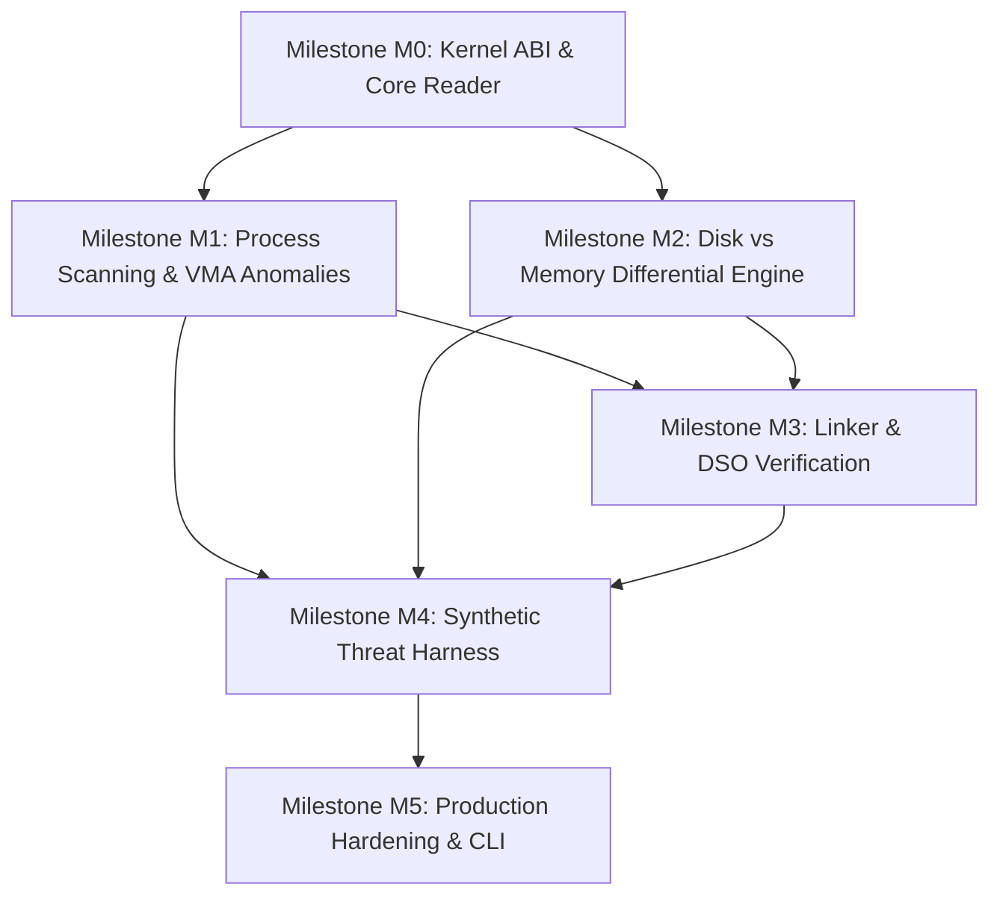

# Engineering Roadmap & Milestone Matrix: Cerberus-Mem

**Target Artifact**: `linux-mem-forensics`  
**Classification**: Engineering Roadmap, Milestone Decomposition & Risk Management  
**Author**: Principal Systems Architect  
**Audience**: OpenCode Core Developer, Engineering Leads, and Security Analysts  

---

## 1. Roadmap Overview & Timeline

The development of `cerberus-mem` is structured into six discrete, sequentially gated milestones (M0 through M5). Each milestone represents an immutable stability boundary: no downstream milestone may commence until all verification criteria and test suites of the prior milestone achieve 100% pass rates under continuous integration.

```
+---------------------------------------------------------------------------------------------------+
|                                  CERBERUS-MEM MILESTONE TIMELINE                                  |
+---------------------------------------------------------------------------------------------------+
|  M0: Core Foundation & Kernel ABI Bindings (Days 1 - 3)                                           |
|      - Linux direct syscall bindings (process_vm_readv, pread64)                                  |
|      - Streaming /proc/maps zero-allocation parser                                                |
|      - Miri strict provenance & memory safety gate                                                |
+---------------------------------------------------------------------------------------------------+
|  M1: Process Enumeration & VMA Anomaly Discovery (Days 4 - 6)                                     |
|      - /proc/$PID/exe, status, and auxv parsers                                                   |
|      - W^X violation detection (RWX page alerts)                                                  |
|      - Anonymous executable page ([anon] + PROT_EXEC) detection                                   |
|      - Fileless memfd execution detection                                                         |
+---------------------------------------------------------------------------------------------------+
|  M2: Disk vs. Memory Differential Engine (Days 7 - 10)                                            |
|      - Static ELF parser (goblin / custom zero-copy header reader)                                |
|      - Relocation exemption mask engine (R_X86_64_RELATIVE, GLOB_DAT)                             |
|      - SHA-256 and byte-level diffing between disk .text and in-memory VMA                        |
|      - Process hollowing & text patching detection                                                |
+---------------------------------------------------------------------------------------------------+
|  M3: Linker & DSO Forensic Verification (Days 11 - 13)                                            |
|      - Dynamic symbol & GOT/PLT table parser                                                      |
|      - Pointer range verification (out-of-bounds GOT targets)                                     |
|      - Inline function trampoline detection (x86_64 JMP detours in libc.so)                       |
+---------------------------------------------------------------------------------------------------+
|  M4: Synthetic Threat Harness & Evasion Validation (Days 14 - 17)                                 |
|      - Autonomous malicious test harness (synthetic memfd, hollower, and GOT-hooker)              |
|      - Zero-theater adversarial validation (100% detection rate on synthetic threats)             |
|      - False-positive benchmarking against standard workstation workloads                         |
+---------------------------------------------------------------------------------------------------+
|  M5: Production Hardening, CLI & SIEM Integration (Days 18 - 20)                                 |
|      - High-performance multi-threaded scanner (Rayon worker pool)                                |
|      - Structured JSON-Lines reporting & quarantine memory dumper                                 |
|      - Release packaging, static binary compilation, man pages                                    |
+---------------------------------------------------------------------------------------------------+
```

---

## 2. Milestone Decomposition & Deliverables

### Milestone M0: Core Foundation & Kernel ABI Bindings
**Objective**: Build safe, zero-overhead Rust abstractions over low-level Linux memory-reading syscalls and streaming procfs parsers.

* **Deliverables**:
  1. `crates/cerberus-core/src/syscalls.rs`: Safe, audited wrappers for `process_vm_readv(2)` and `pread64(2)` with exact libc errno mappings.
  2. `crates/cerberus-core/src/reader.rs`: High-level `MemoryReader` trait implementing chunked reads with automated page-by-page `EFAULT` fallback.
  3. `crates/cerberus-procfs/src/maps.rs`: Zero-allocation streaming parser for `/proc/[pid]/maps` supporting all standard Linux pseudo-device paths and deletion markers.
* **Acceptance Gate**:
  - `cargo miri test` passes with zero undefined behavior or pointer provenance violations.
  - Zero memory allocations during line-by-line parsing of maps buffers up to 10MB.
  - Unit tests verify that reading simulated unmapped memory boundaries cleanly degrades to single-page fallback without crashing.

---

### Milestone M1: Process Enumeration & VMA Anomaly Discovery
**Objective**: Implement host-wide process scanning and detect immediate high-signal memory permission anomalies (W^X violations, anonymous executable regions, and fileless execution).

* **Deliverables**:
  1. `crates/cerberus-procfs/src/process.rs`: Host-wide `/proc` directory walker reading `/proc/[pid]/stat`, `/proc/[pid]/status`, and `/proc/[pid]/cmdline`.
  2. `crates/cerberus-procfs/src/auxv.rs`: ELF auxiliary vector parser extracting `AT_PHDR`, `AT_BASE`, and `AT_ENTRY`.
  3. `crates/cerberus-detect/src/fileless.rs`: Detection of `memfd_create` binaries and deleted backing executables (`/proc/[pid]/exe` symlink ending in ` (deleted)`).
  4. `crates/cerberus-detect/src/wxorx.rs`: Detection of VMAs containing `PROT_READ | PROT_WRITE | PROT_EXEC` and anonymous executable pages (`[anon]` with `PROT_EXEC`).
* **Acceptance Gate**:
  - Successfully detects a synthetic `memfd_create` process running in a background namespace.
  - Correctly flags memory allocated via `mmap(..., PROT_READ|PROT_WRITE|PROT_EXEC, MAP_ANONYMOUS|MAP_PRIVATE, ...)`.
  - Zero false positives on standard system utilities (coreutils, systemd, bash).

---

### Milestone M2: Disk vs. Memory Differential Engine
**Objective**: Implement cryptographic and byte-level differential analysis between on-disk ELF files and live in-memory `.text` segments to uncover process hollowing.

* **Deliverables**:
  1. `crates/cerberus-elf/src/disk.rs`: Static ELF binary parser extracting program headers (`PT_LOAD`), section headers (`.text`, `.rela.text`), and entry points.
  2. `crates/cerberus-elf/src/reloc.rs`: Dynamic relocation mask synthesizer that identifies and excludes expected runtime relocations (`R_X86_64_RELATIVE`, `R_X86_64_GLOB_DAT`, `R_X86_64_JUMP_SLOT`) from comparison buffers.
  3. `crates/cerberus-detect/src/hollowing.rs`: Differential hash engine comparing masked disk bytes against live memory bytes. Identifies modified instructions and flags entry point (`AT_ENTRY`) divergence.
* **Acceptance Gate**:
  - Detects an in-memory modification of a single 4-byte instruction inside `.text` of a running target.
  - Accurately ignores legitimate dynamic relocations in PIE (Position-Independent Executable) binaries, yielding identical hashes between disk and memory on unmodified processes.
  - Extracts and hex-dumps divergent byte spans for forensic analysis.

---

### Milestone M3: Linker & DSO Forensic Verification
**Objective**: Detect evasion techniques that tamper with shared library linkages, including Global Offset Table (GOT) poisoning and inline function hooking.

* **Deliverables**:
  1. `crates/cerberus-elf/src/dynamic.rs`: Parser for dynamic linking structures (`.dynamic`, `.dynsym`, `.dynstr`, `.got`, `.got.plt`).
  2. `crates/cerberus-detect/src/got_poison.rs`: Pointer verification engine checking that all `.got.plt` entries point to valid `.text` segments of loaded DSOs.
  3. `crates/cerberus-detect/src/inline_hook.rs`: Lightweight x86_64 instruction decoder inspecting the prologues of standard `libc.so` exported symbols to identify rogue `JMP` / `CALL` trampolines.
* **Acceptance Gate**:
  - Identifies a poisoned `.got.plt` entry pointed to an anonymous heap staging buffer.
  - Detects a 5-byte `E9` relative jump or 12-byte `48 B8 ... FF E0` trampoline installed in `libc.so!connect`.
  - Distinguishes standard compiler-generated PLT stubs from malicious trampolines.

---

### Milestone M4: Synthetic Threat Harness & Evasion Validation
**Objective**: Build an isolated, adversarial test harness to rigorously test the detection engine against realistic offensive techniques.

* **Deliverables**:
  1. `tests/harness/synthetic_memfd.rs`: Autonomous binary that executes an embedded payload via `memfd_create` and `execveat`.
  2. `tests/harness/synthetic_hollower.rs`: Autonomous binary that spawns a host target, injects code via `/proc/[pid]/mem`, and updates the instruction pointer.
  3. `tests/harness/synthetic_got_hooker.rs`: Autonomous binary that modifies its own `.got.plt` to redirect `puts` to a hidden function.
  4. Integration test suite running all synthetic threats under isolated Linux PID namespaces and asserting detection by `cerberus-mem`.
* **Acceptance Gate**:
  - 100% detection rate (zero false negatives) across all synthetic threat scenarios.
  - End-to-end integration test runner completes in under 15 seconds.
  - Zero crashes or memory leaks detected under AddressSanitizer and LeakSanitizer.

---

### Milestone M5: Production Hardening, CLI & SIEM Integration
**Objective**: Optimize multi-core scanning throughput, finalize the CLI UX, and implement enterprise-grade structured JSON-Lines reporting.

* **Deliverables**:
  1. `crates/cerberus-cli/src/main.rs`: Production CLI featuring targeted PID scan, full host sweep, continuous daemon mode, and quarantine dumping.
  2. `crates/cerberus-report/src/jsonl.rs`: Schema-validated JSON-Lines streaming output generator.
  3. `crates/cerberus-report/src/quarantine.rs`: Secure forensic memory dumper writing suspicious VMAs to disk with `0700` permissions.
  4. Benchmark suite (`benches/scan_throughput.rs`) measuring per-process scan duration and memory footprint.
* **Acceptance Gate**:
  - Full system scan of 300 active processes completes in under 500ms on an 8-core Linux system.
  - Memory consumption of `cerberus-mem` remains under 32MB RSS during peak host scanning.
  - JSON-Lines output validates strictly against the official JSON Schema.

---

## 3. Dependency Graph



---

## 4. Risk Register & Kernel Mitigation Matrix

| Risk ID | Threat / Failure Mode | Probability | Impact | Mitigation Strategy |
| :--- | :--- | :--- | :--- | :--- |
| **R-01** | `process_vm_readv` fails with `EPERM` due to YAMA LSM `ptrace_scope > 0` | High | High | Gracefully detect YAMA restrictions at startup; emit actionable guidance (`setcap cap_sys_ptrace+ep`); fallback to unprivileged procfs metadata inspection. |
| **R-02** | Target process unmaps memory between `/proc/maps` read and memory acquisition (`EFAULT` storm) | High | Medium | Implement two-tier reading: attempt block read, catch `EFAULT`, and transparently decompose request into page-by-page chunks ($4096$ bytes), skipping vanished pages. |
| **R-03** | False positive differential alerts caused by PIE/PIC runtime relocations | Critical | High | Implement relocation masking: parse `.rela.dyn` and `.rela.plt` on disk, calculate runtime offsets, and zero-out dynamic patch sites prior to hashing. |
| **R-04** | Target process crashes or freezes due to aggressive forensic inspection | Low | Critical | Strictly forbid `ptrace(PTRACE_ATTACH)` in standard inspection mode. Rely exclusively on passive, non-pausing kernel syscalls (`process_vm_readv`). |
| **R-05** | High CPU utilization during full host sweeps impacting production daemons | Medium | Medium | Implement configurable nice levels, CPU throttling, and cooperative yield points between process evaluations. Limit scanner thread pool size via Rayon. |
| **R-06** | Forensic memory dumping leads to disk exhaustion or symlink traversal vulnerability | Medium | High | Enforce strict quota limits on dump directory; use `O_NOFOLLOW` and `O_CREAT | O_EXCL` in isolated `/var/log/cerberus/dumps/` with root-only permissions (`0700`). |

---

## 5. Definition of Done (DoD)

A milestone or feature is declared complete if and only if it satisfies all of the following criteria:
1. **Compilation**: Clean build under `cargo build --release` with zero compiler warnings (`-D warnings`).
2. **Memory Safety**: Clean execution under `cargo test` and `cargo miri test` with no undefined behavior, memory leaks, or unaligned pointer accesses.
3. **Test Coverage**: Minimum 85% branch coverage on core parsing and detection crates.
4. **Adversarial Verification**: Passes all automated synthetic malware tests in `tests/harness/` with zero false negatives.
5. **Static Analysis**: Passes `cargo clippy --all-targets -- -D warnings` and `cargo fmt --check`.
6. **Documentation**: All public traits, structs, and error variants include rustdoc documentation (`///`).
